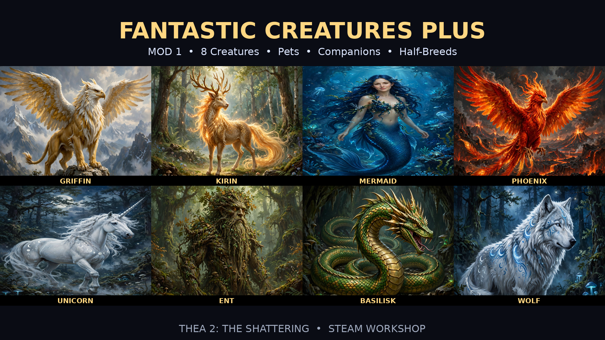

<div align="center">
  
  <h1>Fantastic Creatures Plus</h1>
  <p><strong>Criaturas Fantásticas Plus · Mod para Thea 2: The Shattering</strong></p>
  <p>Encontre, dome e recrute oito criaturas míticas. Acompanhe o crescimento de cada espécie e descubra suas linhagens mestiças.</p>
  <p>
    <a href="https://steamcommunity.com/sharedfiles/filedetails/?id=3838490787"></a>
    <a href="https://github.com/Derictor/FantasticCreaturesPlus/archive/refs/heads/main.zip"></a>
    <a href="https://github.com/Derictor/FantasticCreaturesPlus/issues"></a>
  </p>
  <p><a href="#como-jogar">Como jogar</a> · <a href="#instalação">Instalação</a> · <a href="#compatibilidade-e-suporte">Compatibilidade e suporte</a> · <a href="#arquivos-do-projeto">Arquivos do projeto</a></p>
</div>

## Sobre o mod

Grifo, Kirin, Sereia, Fênix, Unicórnio, Ent, Basilisco e Lobo Lunar podem ser encontrados e recrutados durante a campanha. Cada espécie tem encontros, retratos e habilidades próprios. Os nomes de personagens e habilidades aparecem em inglês, com textos de encontros e descrições do mod em português brasileiro.

## Como jogar

| O que você procura | Como obter |
| --- | --- |
| **Filhote** | Vença **Domar** ou **Recrutar** em um encontro de filhote. Algumas cartas iniciais também concedem filhotes. |
| **Jovem** | Vença **Domar** ou **Recrutar** em um encontro de Jovem, ou acompanhe o primeiro crescimento do Filhote. |
| **Adulto / Auge** | Recrute um adulto em um encontro ou acompanhe o segundo crescimento. Adultos recrutados nos encontros recebem o equipamento padrão da espécie. |
| **Pet equipável** | Vença **Domar** em um encontro adulto e escolha **Levar um pet**. O pet entra no inventário. |
| **Mestiço** | Mantenha um adulto fantástico e um adulto de uma linhagem compatível no mesmo grupo. Um evento raro pode conceder a criança. |

### Crescimento

Cada etapa juvenil tem um contador de **25–45 turnos**. O Filhote começa com um bônus passivo leve. O Jovem ganha uma habilidade ativa e uma passiva de despertar. No Auge, a criatura libera as habilidades de assinatura, como o Mergulho Celestial do Grifo e o Olhar Petrificante do Basilisco.

### Descendência

As **64 combinações de mestiços** cruzam as oito espécies fantásticas com as linhagens humana, élfica, orc, anã, goblin, élfica sombria, demoníaca e bestial. Os eventos aceitam pares adultos de qualquer sexo. Cada combinação pode ocorrer uma vez e exige que o grupo tenha até duas crianças. Dois adultos da mesma espécie fantástica também podem gerar um filhote dessa espécie.

O retrato de Filhote e o de Jovem são compartilhados por linhagem de origem. No Auge, cada combinação mestiça tem um retrato próprio.

Além dos encontros de cada espécie, o mod permite que adultos de linhagens diferentes tenham descendentes. Cada linhagem distinta transmite uma passiva com vantagens e desvantagens. Um filho de Orc–Anão com Elfo recebe as três passivas, que seguem com ele nas próximas fases e gerações. O retrato representa uma linhagem visível. A lista de passivas mostra toda a ascendência reconhecida pelo mod.

## Download

- [**Steam Workshop**](https://steamcommunity.com/sharedfiles/filedetails/?id=3838490787) — assine **Criaturas Fantásticas Plus** para usar a versão distribuída pela Steam.
- [**ZIP do GitHub**](https://github.com/Derictor/FantasticCreaturesPlus/archive/refs/heads/main.zip) — baixe o conteúdo da branch padrão para instalação manual. As atualizações do GitHub e do Workshop são distribuídas separadamente.

## Instalação

### Steam Workshop

1. Assine o item no [Steam Workshop](https://steamcommunity.com/sharedfiles/filedetails/?id=3838490787).
2. Abra **Thea 2: The Shattering**, entre em **Mods** e habilite **Fantastic Creatures Plus**.

### Instalação manual

1. Feche o jogo e [baixe o ZIP do GitHub](https://github.com/Derictor/FantasticCreaturesPlus/archive/refs/heads/main.zip).
2. Extraia a pasta `FantasticCreaturesPlus-main` e renomeie-a para `FantasticCreaturesPlus`.
3. Na biblioteca Steam, abra **Propriedades → Arquivos instalados → Explorar**. Coloque a pasta extraída em `Thea2_Data/StreamingAssets/Mods/`.
4. Confirme que `info.txt` está no local abaixo. Abra o jogo e habilite **Fantastic Creatures Plus** no menu **Mods**.

   ```text
   Thea 2 The Shattering/
   └── Thea2_Data/
       └── StreamingAssets/
           └── Mods/
               └── FantasticCreaturesPlus/
                   ├── info.txt
                   ├── Events.xml
                   ├── DB/
                   ├── Images/
                   └── Localization/
   ```

Para atualizar a instalação manual, feche o jogo e substitua a pasta do mod pela nova cópia. Habilite apenas uma instalação do mod por vez.

## Cooperativo

Todos os jogadores devem instalar a mesma versão do mod, ativar a mesma lista de mods na mesma ordem e reiniciar o jogo antes de entrar na sala. Use a mesma versão do Thea 2 em todos os computadores.

Aliados podem participar dos encontros. O personagem ou pet conquistado entra no grupo que iniciou o encontro. Nascimentos e crescimento são processados para o grupo correspondente. No mapa online, todos usam os modelos nativos associados às criaturas. O 3D procedural fica disponível no modo solo com Harmony.

## Compatibilidade e suporte

A versão de referência é a edição **Steam para Windows**. A inicialização chegou ao menu principal. O [roteiro de testes](docs/PLAYTEST.md) lista os cenários de campanha a verificar, incluindo nascimentos, recompensas de pets e preservação de equipamento no crescimento.

<details>
<summary>O mod não aparece no menu</summary>

Confira se o arquivo está em `Mods/FantasticCreaturesPlus/info.txt` e se a extração criou apenas um nível de pasta para o mod. Verifique se há outra cópia instalada pelo Workshop.

</details>

Para relatar um problema, abra uma [issue no GitHub](https://github.com/Derictor/FantasticCreaturesPlus/issues/new) com a versão do jogo, os mods ativos e os passos para reproduzir. Se for um encontro, inclua a espécie, a fase e a opção escolhida.

## Arquivos do projeto

- [Manifesto](info.txt) e [módulo de eventos](Events.xml) — arquivos que o jogo carrega.
- [Bancos de dados](DB/) e [linhagens mestiças](DB/Lineages/) — personagens, habilidades, equipamento e regras de jogo.
- [Imagens](Images/) e [localização](Localization/) — retratos, ícones, arte dos encontros e textos PT-BR.
- [Guia de manutenção](docs/PROJECT.md) — estrutura dos arquivos, validação e notas do projeto.

## Créditos

- **Mod** · [Derictor](https://github.com/Derictor)
- **Jogo** · [Thea 2: The Shattering, da MuHa Games e Eerie Forest Studio](https://store.steampowered.com/app/606230/Thea_2_The_Shattering/)
